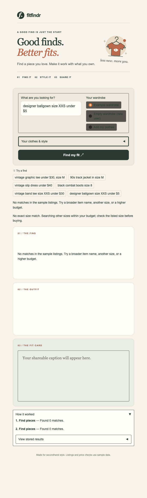

# Check results

Checked on October 12, 2026 with Python 3.13.

- `python -m pytest tests/ -q`: **79 passed**. No live key needed for tests.
- `python -m pip check`: no broken dependencies.
- Data loader: 40 listings and 10 example wardrobe pieces.
- Live full workflow: all four tools completed. The selected tee was `lst_033`,
  $19; comparison median was $21. Both AI tools used the announced replacement.
- Two live captions for the same outfit differed.
- Live empty wardrobe: returned an outfit with suggested extra pieces.
- Failed ballgown search: two attempts, no outfit/card call, helpful message.
- Empty outfit: `Error: Add an outfit before making a fit card.`
- Browser: all three panels populated with live replies; saved custom clothes
  and preferences survived refresh; clearing the profile restored defaults.
- Browser: failure message appeared and later panels stayed empty.
- Secret check: `.env` is ignored and absent from tracked files.

[Actual live outputs and saved state](live-checks.json)

