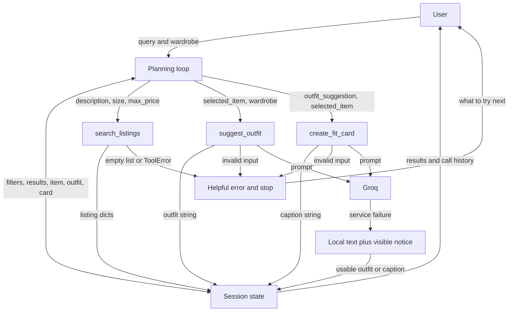

# FitFindr plan

Written before implementation. The first commit saves this plan. Stretch plans
will be added before those features are built.

## Tools

### Tool 1: search_listings

`search_listings(description: str, size: str | None = None, max_price: float | None = None) -> list[dict]`

Find pieces using `load_listings()`. `description` names the item and style.
`size` is an optional label; M matches S/M, but not XL. `max_price` is an
optional, inclusive dollar limit.

Return matching listing dicts, best match first. Each keeps `id`, `title`,
`description`, `category`, `style_tags` (list[str]), `size`, `condition`,
`price` (float), `colors` (list[str]), `brand` (str or None), and `platform`.
Rank title and tag matches above description matches; require the clothing kind
when one is named. Break ties by price, then id.

Return `[]` for no matches or blank input. Bad filters or unreadable data raise
`ToolError` with a short message; the loop catches it and stops.

### Tool 2: suggest_outfit

`suggest_outfit(new_item: dict, wardrobe: dict) -> str`

`new_item` is a listing dict. `wardrobe` has `items: list[dict]`; pieces have
`id`, `name`, `category`, `colors`, `style_tags`, and optional `notes`.
It may also have `style_preferences: str`.

Call Groq and return one or two short, complete outfits with a styling tip.
Name owned pieces. With an empty or small wardrobe, label added pieces as
suggestions rather than claiming the user owns them.

Invalid inputs return an `Error:` string. If Groq fails or the key is missing,
return a useful local outfit prefixed `Fallback:` with the cause. The loop
shows that notice and passes only the useful outfit text into the card tool.

### Tool 3: create_fit_card

`create_fit_card(outfit: str, new_item: dict) -> str`

`outfit` is the outfit suggestion; `new_item` is the same listing dict.
Call Groq at temperature 1.0. Return a casual, two- to four-sentence caption
mentioning the item, price, platform, and outfit. Different inputs must produce
different captions; repeated calls should vary too.

Blank outfit text or missing item details return an `Error:` string. A missing
key, timeout, empty AI response, or service error returns a marked `Fallback:`
caption built from the actual item and outfit. Never include error notices
inside the shareable caption.

## Planning Loop

1. Create a new session. Reject a blank query before calling tools.
2. Read size and budget with regular expressions. Remove these and wardrobe/chat
   phrases from the search description. Store `parsed`.
3. While unfinished, choose the next action from the session's missing values.
4. Without search results, call `search_listings` and store the list. If empty,
   set `error`: “No matches in the sample listings. Try a broader item name,
   another size, or a higher budget.” Stop; never style an empty item.
5. With results but no selected item, store the exact `results[0]` dict.
6. Without an outfit, call `suggest_outfit(selected_item, wardrobe)`. An `Error:`
   result ends the run; a `Fallback:` adds a notice and keeps useful text.
7. Without a card, call `create_fit_card(outfit_suggestion, selected_item)`.
   Store useful text. An `Error:` stops and keeps earlier results.
8. Return when the card exists. Record calls and outcomes in `steps`.

This is a conditional loop: failed searches never reach later tools. Parsing
uses no AI, so filters can be checked without a key.

## State Management

`run_agent(query: str, wardrobe: dict) -> dict` creates a session per query:

- `query`, `parsed`, `wardrobe`: request, filters, and owned pieces.
- `search_results`, `selected_item`: results and their first listing dict.
- `outfit_suggestion`, `fit_card`: useful text from later tools.
- `error`: message on an early stop; otherwise None.
- `notices`, `steps`: fallback messages and visible call history.

The selected dict flows directly into both later tools. The saved outfit string
flows directly into the card. A new query cannot reuse old search results.

## Error Handling

| Tool | Failure | Response |
| --- | --- | --- |
| search_listings | No matches | Stop; ask for a broader item name, another size, or a higher budget. |
| search_listings | Bad budget or data | Catch ToolError; show the cause and ask the user to fix the filter or data file. |
| suggest_outfit | Empty wardrobe | Give a complete general outfit and label extra pieces as suggestions. |
| suggest_outfit | Only one owned piece | Use it when suitable; label missing pieces as suggestions. |
| suggest_outfit | Bad item/wardrobe | Show an Error message; skip the card. |
| suggest_outfit | Groq unavailable | Explain the cause; show a useful local outfit and continue. |
| create_fit_card | Missing outfit/item | Show “Error: Add an outfit before making a fit card.” or a missing-item message. Keep earlier work. |
| create_fit_card | Groq unavailable/empty reply | Explain the cause; create a local caption from the real inputs. |

## Architecture

## AI Tool Plan

- **Milestone 1:** Give Codex the assignment, data, and loader. Check its summary
  against the 40 listings and the wardrobe fields.
- **Milestone 2:** Give Codex the signatures and starter plan. Review this plan's
  exact inputs, outputs, branches, and diagram before writing code.
- **Milestone 3:** Give Codex each Tool block, Error Handling, and the loader,
  one tool at a time. Build in `tools.py`. Check filters, no results, empty
  wardrobe, missing outfit, and mocked AI failures using
  `python -m pytest tests/test_tools.py` before connecting the loop.
- **Milestone 4:** Give Codex Planning Loop, State Management, and the full
  Architecture diagram. Build `agent.py` and connect `app.py`. Tests must show
  the same item reaches both tools, the saved outfit reaches the card, and
  no-result runs skip styling and captions.
- **Milestone 5:** Give Codex the Error Handling rows. Trigger each failure;
  check the visible message and early stop. Save test evidence.
- **Milestone 6:** Give Codex the final code, plan, and test results. Write a
  short README and compare every signature with code. Check all app panels
  in a browser. The user will record and link the video later.

## A Complete Interaction (Step by Step)

FitFindr finds a secondhand piece, pairs it with owned clothes, and writes a
caption. A request triggers search; a match unlocks styling, and a usable outfit
unlocks the card. A failed search stops with a helpful message; an AI outage
uses clearly marked local text.

**Query:** “I'm looking for a vintage graphic tee under $30. I mostly wear baggy
jeans and chunky sneakers. What's out there and how would I style it?”

1. Extract `description="vintage graphic tee"`, `size=None`, `max_price=30.0`.
   Call `search_listings("vintage graphic tee", None, 30.0)`.
2. Store ranked results. The expected first match is `lst_033`, Vintage Band
   Tee — Faded Grey, $19, size L, good condition, depop. Set `selected_item`
   to that dict without re-entering its fields.
3. Call `suggest_outfit(selected_item, get_example_wardrobe())`. Save an outfit
   such as the tee with Baggy straight-leg jeans, dark wash, and Chunky white
   sneakers. AI wording can vary.
4. Call `create_fit_card(outfit_suggestion, selected_item)`. Save a caption
   mentioning the $19 depop tee and those jeans/sneakers.
5. Show listing, outfit, caption, and call history. For “designer ballgown size
   XXS under $5,” show the no-match message; leave outfit/card unset.

## Model choice

Try the course model `meta-llama/llama-4-scout-17b-16e-instruct` first.
Groq [retired it on July 17, 2026](https://console.groq.com/docs/deprecations).
On a model-unavailable response, retry once with `openai/gpt-oss-120b`, Groq's
recommended replacement, and show a notice. `GROQ_MODEL` and
`GROQ_FALLBACK_MODEL` in `.env` can change these choices. Use a 20-second
 timeout and no hidden SDK retries.
